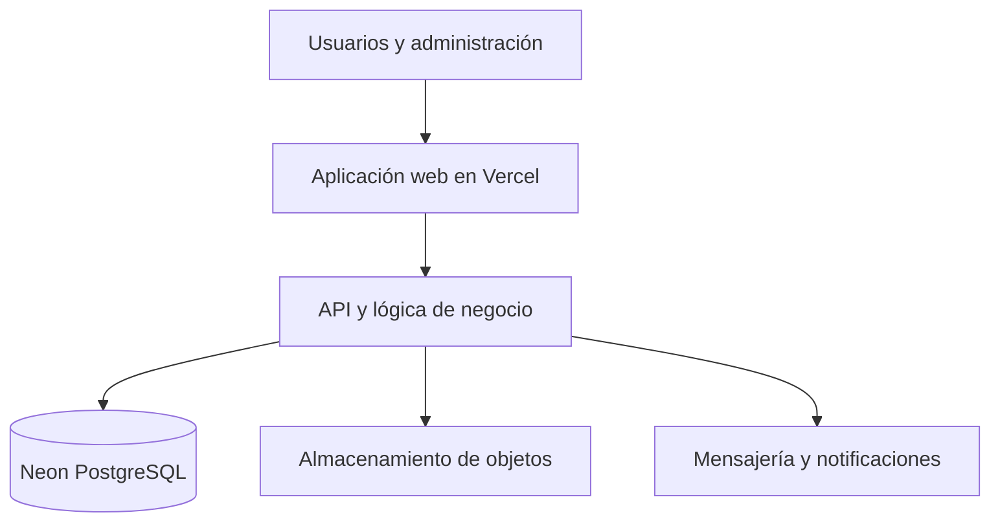

# Mi Hogar en Línea

## 1. Contexto del producto

| Atributo | Definición |
|---|---|
| Producto | Mi Hogar en Línea |
| Mercado inicial | Quibdó, Chocó, Colombia |
| Modelo | Marketplace inmobiliario de dos lados |
| Sector | Arrendamiento de vivienda |
| Plataforma | Aplicación web responsiva |
| Idioma | Español |
| Moneda | COP |
| Zona horaria | America/Bogota |
| Equipo | Cuatro desarrolladores |
| Historial técnico | [BITACORA.md](./BITACORA.md) |

Mi Hogar en Línea centraliza la oferta inmobiliaria y facilita la comunicación directa entre arrendadores y arrendatarios. Los propietarios administran sus propias publicaciones, sin depender de terceros para promocionar sus inmuebles.

### Objetivos

- Mejorar la visibilidad y el acceso a la oferta inmobiliaria local.
- Facilitar la búsqueda, comparación y consulta de propiedades.
- Centralizar la comunicación mediante mensajería interna.
- Reducir desplazamientos innecesarios mediante información y contenido multimedia.
- Incorporar mecanismos de confianza, privacidad y prevención del fraude.
- Construir un producto sostenible, mantenible y escalable.

La plataforma facilita el contacto y la gestión inmobiliaria. No representa jurídicamente a las partes ni garantiza la titularidad de los inmuebles, el cumplimiento contractual o la seguridad física de los usuarios.

## 2. Principios y decisiones del producto

| ID | Decisión vigente |
|---|---|
| D-001 | Quibdó como mercado inicial y publicación directa por los propietarios. |
| D-002 | Mensajería interna como canal central de comunicación. |
| D-003 | Exclusión de publicidad de terceros. |
| D-004 | Neon PostgreSQL integrado mediante Vercel Marketplace y Vercel como plataforma objetivo de despliegue. |
| D-005 | Exclusión de Cloudinary. |
| D-006 | Reutilización prioritaria de recursos, control de costos y gestión de deuda técnica. |

La selección de tecnologías complementarias y las modificaciones de arquitectura se sustentan en requisitos, compatibilidad, seguridad, costos y capacidad operativa. La aprobación de nuevas decisiones se registra en el historial técnico.

## 3. Actores y control de acceso

| Actor | Capacidades funcionales |
|---|---|
| Visitante | Consultar catálogo, filtros y fichas públicas sin autenticación. |
| Arrendatario | Administrar perfil, favoritos y conversaciones propias. |
| Arrendador | Administrar inmuebles y publicaciones propias, multimedia, disponibilidad y conversaciones. |
| Administrador | Moderar publicaciones, gestionar reportes y administrar usuarios según permisos. |
| Superadministrador | Administrar permisos y configuración privilegiada cuando la estructura operativa lo requiera. |

El modelo de autorización combina roles, permisos, estado de cuenta y pertenencia de los recursos. Las operaciones privadas requieren autorización del lado servidor. La administración opera bajo el principio de mínimo privilegio.

## 4. Arquitectura funcional

El inventario representa el alcance funcional de referencia, no un reporte de funcionalidades implementadas. La priorización de cada incremento corresponde al backlog del producto.

| ID | Dominio | Capacidades |
|---|---|---|
| MH-ID | Identidad y cuenta | Registro, autenticación, recuperación, perfil, roles y verificación. |
| MH-PROP | Inmuebles y publicaciones | Registro, edición, características, precio, ubicación por barrio, disponibilidad y moderación. |
| MH-CAT | Catálogo | Listado público, filtros, búsqueda, fichas y paginación. |
| MH-MEDIA | Multimedia | Fotografías, portada, orden, videos y gestión de archivos. |
| MH-CHAT | Mensajería | Conversaciones por publicación, mensajes, historial, lectura y archivado. |
| MH-ADMIN | Administración | Usuarios, publicaciones, configuración, reportes y métricas operativas. |
| MH-TRUST | Confianza y seguridad | Denuncias, bloqueos, verificación, privacidad y controles contra abuso. |
| MH-FAV | Favoritos | Registro y consulta de inmuebles guardados. |
| MH-NOT | Notificaciones | Alertas de mensajes, interacciones y cambios relevantes. |
| MH-DASH | Paneles | Gestión de publicaciones, actividad, conversaciones y operaciones administrativas. |
| MH-VISIT | Visitas | Solicitud, aceptación, rechazo y cancelación de visitas. |
| MH-RENT | Arrendamientos | Registro de acuerdos, consulta y archivado de arrendamientos. |
| MH-CONTRACT | Contratos | Generación de Word editable, carga de PDF firmado, consulta y descarga privada. |
| MH-ANALYTICS | Analítica | Visualizaciones, contactos, actividad, moderación y adopción. |
| MH-BILL | Monetización | Herramientas profesionales y gestión de suscripciones cuando se apruebe el modelo comercial. |

### 4.1. Publicación de inmuebles

1. Autenticación del arrendador y validación de sus permisos.
2. Creación del borrador con información y contenido multimedia.
3. Revisión y moderación conforme a la política de publicación.
4. Publicación en el catálogo tras la aprobación correspondiente.
5. Actualización de disponibilidad, pausa, marcación como arrendado o archivado.

El estado de moderación y el estado de disponibilidad constituyen conceptos independientes. La modificación de información sensible puede requerir una nueva revisión. Las transiciones de estado se validan en el servidor.

### 4.2. Búsqueda y comunicación

1. Consulta del catálogo y aplicación de filtros.
2. Visualización de las características y multimedia del inmueble.
3. Autenticación para iniciar una conversación vinculada a la publicación.
4. Intercambio de mensajes entre participantes autorizados.
5. Gestión de favoritos, solicitudes de visita y reportes conforme al alcance habilitado.

### 4.3. Arrendamientos y contratos

La gestión de arrendamientos y contratos forma parte del alcance de referencia. Su incorporación a cada entrega depende de la implementación existente y la planificación del producto.

El modelo distingue entre inmueble, publicación y relación de arrendamiento cuando el historial operativo lo exige. Los documentos contractuales son privados y accesibles exclusivamente mediante autorización. La generación de contratos no constituye un servicio de firma electrónica. Las plantillas contractuales requieren revisión jurídica.

### 4.4. Alcance de evolución

Los pagos de cánones o depósitos, firma electrónica, verificación biométrica, recorridos 360°, recomendaciones mediante IA y aplicaciones nativas requieren una definición de alcance independiente. La incorporación de microservicios o infraestructura especializada responde exclusivamente a necesidades comprobadas.

## 5. Arquitectura tecnológica

### 5.1. Infraestructura objetivo

| Componente | Criterio técnico |
|---|---|
| Despliegue | Vercel |
| Base de datos | Neon PostgreSQL, integrado con Vercel Marketplace |
| Arquitectura de aplicación | Modularidad y separación de responsabilidades proporcional a la complejidad del producto. |
| Frameworks y ORM | Reutilización de las tecnologías existentes que satisfagan los requisitos y sean compatibles con la infraestructura. |
| Archivos | Almacenamiento de objetos separado de la base de datos relacional. |
| Búsqueda | Capacidades nativas de PostgreSQL como primera alternativa. |
| Mensajería | Persistencia en PostgreSQL y transporte compatible con el entorno de despliegue. |
| Integración continua | GitHub y Vercel como herramientas de referencia para revisión, validación y despliegue. |

Vercel Blob constituye una alternativa de almacenamiento integrada, sujeta a evaluación de acceso privado, límites, transferencia y costos. La infraestructura evita componentes redundantes y servicios adicionales sin justificación técnica.

### 5.2. Base de datos

- Modelo relacional con claves foráneas, restricciones de unicidad e integridad transaccional.
- Migraciones versionadas, revisadas y validadas en ambientes no productivos.
- Conexiones y pools adecuados para el entorno de ejecución.
- Índices definidos según patrones de consulta y evidencia de rendimiento.
- Búsqueda textual, filtros y agregaciones mediante PostgreSQL cuando cubran los requisitos.
- Aislamiento de datos y credenciales entre ambientes.

El modelo conceptual comprende usuarios, perfiles, inmuebles, publicaciones, multimedia, ubicaciones, favoritos, conversaciones, participantes, mensajes, reportes, bloqueos, notificaciones y auditoría. Las entidades de visitas, arrendamientos, contratos y facturación se incorporan conforme a su alcance funcional. La implementación debe preservar las estructuras existentes que satisfagan los requisitos.

### 5.3. Multimedia

- Almacenamiento de archivos fuera de PostgreSQL; persistencia de referencias y metadatos en Neon.
- Cargas autorizadas, validación de formatos, límites, propiedad del recurso y contenido.
- Separación de multimedia pública aprobada y documentos privados.
- Optimización de imágenes y reproducción HTML5 cuando resulten suficientes.
- Restricciones de tamaño, duración y cantidad de archivos de acuerdo con el presupuesto operativo.
- Eliminación de metadatos de ubicación innecesarios y gestión de archivos huérfanos.
- Reproducción automática de videos desactivada.

### 5.4. Mensajería

- Persistencia de mensajes antes de confirmar su recepción.
- Autorización por pertenencia a la conversación.
- Identificación de mensajes y deduplicación de reintentos.
- Paginación por cursor, historial y estados de lectura.
- Límites de frecuencia, bloqueo y reporte de usuarios.
- Separación entre lógica de negocio y transporte de mensajes.

La entrega de mensajes puede utilizar polling adaptativo, conexiones persistentes o servicios administrados según compatibilidad y requisitos comprobados. La memoria de una instancia no constituye una fuente de verdad compartida. La incorporación de Redis o un broker requiere una justificación de volumen, latencia o confiabilidad.

### 5.5. Ambientes y operación

| Ambiente | Finalidad |
|---|---|
| Desarrollo | Implementación local y pruebas con datos sintéticos. |
| Preview / Staging | Validación de Pull Requests, integración y migraciones. |
| Producción | Operación con datos reales y acceso restringido. |

Las variables de entorno se gestionan por ambiente. Los recursos productivos requieren control de acceso, observabilidad, copias o mecanismos de recuperación y procedimientos de rollback. La operación comercial utiliza planes compatibles con las condiciones de servicio y el presupuesto aprobado. Los costos de almacenamiento, transferencia, funciones y base de datos forman parte de la supervisión operativa.

## 6. Seguridad y privacidad

| Área | Control |
|---|---|
| Identidad | Soluciones mantenidas de autenticación, sesiones seguras, expiración y revocación. |
| Autorización | RBAC, mínimo privilegio y validación de pertenencia en servidor. |
| Entradas | Validación de esquemas, consultas parametrizadas y manejo seguro de errores. |
| Aplicación web | Protección contra XSS, CSRF, abuso de endpoints y escalamiento de privilegios. |
| Archivos | Acceso autorizado, validación de contenido y almacenamiento privado para información sensible. |
| Privacidad | Minimización de datos, consentimiento, retención, eliminación y atención de derechos. |
| Auditoría | Registro de actor, acción, recurso, fecha y resultado de operaciones privilegiadas. |
| Secretos | Variables de entorno y mecanismos seguros de gestión de credenciales. |
| Dependencias | Revisión de vulnerabilidades, mantenimiento y licencias. |

### Seguridad de los usuarios

La ubicación exacta y los datos personales de contacto no se exponen públicamente por defecto. La plataforma incorpora reportes, bloqueo, moderación y advertencias sobre pagos anticipados sospechosos. Los mecanismos de visita y verificación deben reducir la exposición a riesgos físicos sin garantizar la seguridad de los encuentros.

La verificación de contacto, identidad y autorización sobre un inmueble son procesos diferenciados. Los documentos de identidad y comprobantes financieros requieren un flujo privado específico, distinto de la mensajería ordinaria. El acceso administrativo a evidencias de reportes se limita a finalidades autorizadas y se audita.

El tratamiento de datos personales y las condiciones contractuales se ajustan a políticas aprobadas y a la revisión jurídica aplicable en Colombia. Los ambientes de pruebas y las herramientas de desarrollo utilizan datos sintéticos o debidamente autorizados.

## 7. Experiencia de usuario y rendimiento

- Diseño mobile-first, responsivo y accesible.
- Navegación clara y formularios con validación y recuperación de errores.
- Componentes, estilos y tokens visuales reutilizables.
- Estados de carga, vacío, error, reintento y éxito.
- Catálogo paginado y contenido multimedia optimizado para conexiones variables.
- SEO para páginas públicas y exclusión de áreas privadas de la indexación.
- Evaluación de rendimiento con dispositivos móviles y conectividad limitada.
- PWA como alternativa de evolución; protección de información privada frente a cachés locales.

## 8. Estándares de ingeniería

- Aplicación proporcional de KISS, YAGNI, DRY y separación de responsabilidades.
- Reutilización de componentes, servicios, modelos, utilidades y capacidades nativas antes de introducir nuevas implementaciones.
- Adopción de bibliotecas mantenidas cuando los recursos existentes no cubran los requisitos.
- Consistencia con las convenciones, estructura y gestor de paquetes del repositorio.
- Cambios incrementales, tipado consistente y contratos de API compatibles con sus consumidores.
- Dependencias justificadas por requisitos, compatibilidad, seguridad y costo de mantenimiento.
- Refactorizaciones delimitadas por problemas concretos y respaldadas por pruebas.
- Registro de deuda técnica mediante issues con impacto, prioridad y criterio de resolución.
- Prohibición de credenciales en código, mocks productivos, desactivación injustificada de validaciones y silenciamiento de errores.

## 9. Calidad y validación

La estrategia de pruebas comprende validación unitaria de reglas de negocio, integración de API y persistencia, pruebas E2E de flujos críticos y regresión de defectos corregidos. Los controles incluyen escenarios negativos, autorización entre cuentas, reintentos, migraciones y adaptación móvil.

### Definition of Done

- [ ] Criterios de aceptación satisfechos.
- [ ] Reutilización y decisiones técnicas justificadas.
- [ ] Validación de entradas, permisos y privacidad.
- [ ] Pruebas correspondientes ejecutadas con evidencia.
- [ ] Lint, comprobación de tipos y build satisfactorios, según los scripts del repositorio.
- [ ] Migraciones y configuración revisadas cuando corresponda.
- [ ] Compatibilidad y regresiones evaluadas.
- [ ] Pull Request revisado y aprobado por otro desarrollador.
- [ ] Bitácora actualizada.
- [ ] Contexto actualizado cuando se aprueben cambios de arquitectura o producto.

## 10. Organización del equipo

La responsabilidad se distribuye por dominios funcionales. Cada desarrollador participa en implementación, pruebas, documentación y revisión de código.

| Responsable | Dominio | Responsabilidades |
|---|---|---|
| Dev 1 — Líder técnico e integración | Arquitectura, identidad e infraestructura | Autenticación, autorización, Neon, Vercel, CI/CD, ambientes, migraciones y coordinación técnica. |
| Dev 2 — Oferta inmobiliaria | Propiedades y multimedia | Inmuebles, publicaciones, disponibilidad, panel del arrendador, archivos e integración con moderación. |
| Dev 3 — Demanda y experiencia | Catálogo y UX/UI | Búsqueda, filtros, fichas, favoritos, panel del arrendatario, componentes compartidos, accesibilidad y SEO. |
| Dev 4 — Interacción y confianza | Mensajería y administración | Chat, notificaciones, reportes, bloqueos, moderación, seguridad del contacto y gestión de visitas, arrendamientos y contratos. |

### Revisión cruzada

| Responsables | Ámbito |
|---|---|
| Dev 1 y Dev 4 | Identidad, seguridad, infraestructura y comunicación. |
| Dev 2 y Dev 3 | Propiedades, catálogo, multimedia y experiencia. |

Los cambios transversales requieren coordinación con los responsables de los dominios afectados. La priorización y aceptación del alcance corresponden a la responsabilidad de producto. La calidad es una responsabilidad compartida.

## 11. Gestión del desarrollo

### 11.1. Planificación

GitHub Issues y GitHub Projects constituyen el flujo de referencia para la gestión del trabajo. El tablero utiliza los estados `Backlog`, `Ready`, `In Progress`, `In Review`, `Validation` y `Done`. Las incidencias incluyen alcance, criterios de aceptación, dependencias, prioridad y responsable.

La cadencia de referencia es de dos semanas, ajustada a la capacidad del equipo. La planificación, sincronización, revisión del incremento y retrospectiva estructuran cada ciclo. El límite inicial de trabajo en curso es una historia activa por desarrollador.

### 11.2. Control de versiones

La estrategia de referencia utiliza `main` protegida, ramas de corta duración por issue y Pull Requests revisados. Las políticas existentes del repositorio se conservan cuando satisfacen los controles de calidad.

| Tipo | Convención de rama |
|---|---|
| Funcionalidad | `feat/mh-123-catalogo` |
| Corrección | `fix/mh-124-permisos` |
| Refactorización | `refactor/mh-125-property-service` |
| Infraestructura | `chore/mh-126-ci` |
| Documentación | `docs/mh-127-contexto` |
| Pruebas | `test/mh-128-listing-flow` |

Los Pull Requests incluyen referencia a la issue, descripción del cambio, pruebas, impacto y documentación relevante. Las integraciones requieren revisión humana independiente y validación de CI. Los despliegues productivos y cambios sensibles requieren autorización. El trabajo concurrente utiliza ramas y directorios de trabajo aislados; los esquemas, migraciones, lockfiles, autenticación y configuración compartida se coordinan entre responsables.

### 11.3. Evaluación inicial del repositorio

| Responsable | Ámbito de evaluación |
|---|---|
| Dev 1 | Stack, dependencias, autenticación, base de datos, ambientes, scripts y despliegue. |
| Dev 2 | Modelo de inmuebles, publicaciones, permisos y multimedia. |
| Dev 3 | Rutas, catálogo, filtros, componentes y diseño responsivo. |
| Dev 4 | Mensajería, administración, privacidad, arrendamientos y contratos. |
| Equipo | Consolidación de evidencia, pruebas base y priorización del backlog. |

La clasificación funcional se basa en código, pruebas y evidencia de ejecución. El primer incremento de producto prioriza el flujo completo de publicación, moderación, búsqueda y contacto autorizado.

## 12. Modelo comercial e indicadores

El modelo comercial excluye publicidad de terceros. La publicación gratuita y las suscripciones por herramientas profesionales constituyen alternativas de monetización sujetas a validación comercial. Las funcionalidades esenciales de seguridad no se condicionan a un pago. La custodia de dinero de arrendamientos requiere una definición legal y operativa independiente.

Los indicadores de producto comprenden propietarios activos, publicaciones disponibles, búsquedas con resultados, contactos por publicación, tiempo de primera respuesta, reportes, tiempo de moderación, conversión a contacto y retención de propietarios. Los indicadores técnicos incluyen consumo de infraestructura, rendimiento y costos operativos. Su medición requiere fuentes, ventanas temporales y denominadores definidos.

## 13. Normas de modificación y documentación

La implementación se fundamenta en el contexto vigente, la issue asignada, el código relacionado y el historial técnico. Los cambios deben limitarse al alcance autorizado y preservar el trabajo de otros integrantes. Las pruebas y resultados registrados corresponden a ejecuciones reales.

`AGENTS.md` consolida las decisiones vigentes; `BITACORA.md` conserva la evolución técnica; Git registra los cambios de código y GitHub Issues administra el trabajo. Las modificaciones arquitectónicas, de alcance, seguridad, datos o costos requieren aprobación y trazabilidad. Las operaciones destructivas, el uso de credenciales productivas para pruebas y los despliegues sin autorización están prohibidos.

## 14. Referencia documental

Proyecto Mi Hogar en Línea, Dinámica de Sistemas, Fundación Universitaria Claretiana, 2026. Documento de referencia funcional y metodológica de 13 páginas. El estado de implementación se determina mediante evidencia del repositorio y sus entornos de ejecución.
